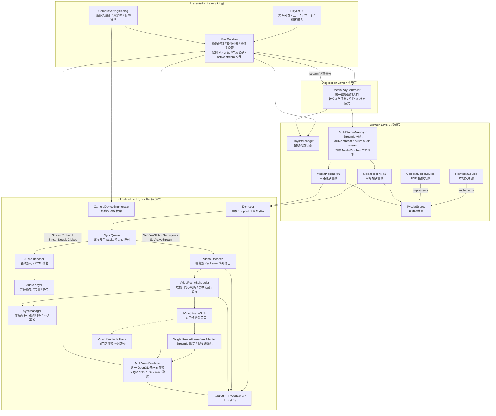
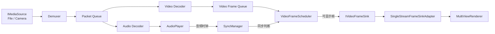

# TinyVideoProcessor

<p align="center">
  <strong>A lightweight yet powerful video processing framework</strong>
</p>

<p align="center">
  基于 Qt6 和 FFmpeg 的轻量级视频处理框架<br>
  从简单播放器演进为专业的多路视频处理平台
</p>

<p align="center">
  <a href="#-特性">特性</a> •
  <a href="#-架构设计">架构</a> •
  <a href="#-快速开始">快速开始</a> •
  <a href="#-演进路线">演进路线</a> •
  <a href="#-技术栈">技术栈</a>
</p>

---

## 📖 项目简介

TinyVideoProcessor 是一个渐进式演进的视频处理框架，遵循清晰的架构设计原则，从基础的视频播放器逐步扩展为支持多路视频源、实时图像处理和智能分析的专业平台。

### 设计理念

- **渐进式演进**：每个阶段都是完整可用的版本，不是功能堆砌
- **架构优先**：清晰的分层设计，易于理解和扩展
- **开放封闭**：通过接口抽象支持新功能，无需修改现有代码
- **轻量高效**：精简的代码，优异的性能

---

## ✨ 特性

### 当前版本

- ✅ 本地文件播放、播放列表、上一个/下一个、循环模式
- ✅ 播放、暂停、停止、Seek、快进/快退、播放速度控制
- ✅ 音量调节、静音控制、无音频流视频兼容
- ✅ `IMediaSource` 媒体源抽象，已支持文件源和摄像头源基础接入
- ✅ 单路 `MediaPipeline` 播放管线，解耦 UI 与底层解码播放链路
- ✅ `MultiStreamManager` 多路播放管理，支持 active stream / active audio stream
- ✅ `VideoFrameScheduler` 视频帧调度，负责取帧、同步判断、丢帧和调度
- ✅ `MultiViewRenderer` 统一 OpenGL 多画面渲染，支持 `Single` / `2x2` / `3x3` / `4x4`
- ✅ 多路文件/摄像头混合预览基础能力
- ✅ 双击单路聚焦与恢复
- ✅ 多线程解码、音视频同步、硬件解码基础支持

### 规划中的功能

#### Phase 1: 完善播放器
- [x] 进度条拖动（Seek）
- [x] 播放列表管理
- [x] 播放速度控制
- [x] 快进/快退
- [x] 全屏模式
- [ ] 配置持久化

#### Phase 2: 摄像头支持
- [x] USB 摄像头采集 MVP
- [x] 设备枚举与选择
- [x] 分辨率/帧率设置
- [x] 实时预览基础链路
- [ ] 摄像头参数持久化
- [ ] 摄像头截图功能

#### Phase 3: 多路视频
- [x] 多路播放管理
- [x] 统一 `MultiViewRenderer` 多画面渲染
- [x] 灵活布局（Single, 2x2, 3x3, 4x4）
- [x] active stream / active audio stream 策略
- [x] 单路聚焦与恢复
- [ ] 非 YUV420P / 4K MKV 显示质量完善
- [ ] 多路渲染性能优化
- [ ] 9/16 路真实播放扩容

#### Phase 4: 网络流
- [ ] RTSP 流播放
- [ ] RTMP 流播放
- [ ] HTTP-FLV 支持
- [ ] 断线重连

#### Phase 5-6: 图像处理与分析
- [ ] 实时图像处理（灰度化、二值化、边缘检测）
- [ ] 插件式处理器架构
- [ ] 目标检测与识别
- [ ] 尺寸测量
- [ ] 运动检测与跟踪

---

## 🏗️ 架构设计

### 分层架构



### 核心数据流



### 职责边界

- `MainWindow`：只负责 UI、逻辑 slot、布局切换和用户交互转发。
- `MediaPlayController`：应用层播放入口，对 UI 屏蔽单路和多路播放细节。
- `MultiStreamManager`：管理 `StreamId`、active stream、active audio stream 和多路 `MediaPipeline` 生命周期。
- `MediaPipeline`：只负责单路媒体播放，不感知 `StreamId`，不决定多路布局。
- `VideoFrameScheduler`：负责取帧、同步判断、丢帧追赶和下一帧调度。
- `MultiViewRenderer`：只负责统一 OpenGL 多画面绘制，不访问队列、不访问 `SyncManager`、不做同步判断。

### 核心设计模式

**1. 策略模式 - 媒体源抽象**
```cpp
class IMediaSource {
    virtual bool Open() = 0;
    virtual bool Close() = 0;
    // 提供 FFmpeg 格式上下文、媒体信息和源类型
};

// 不同的媒体源实现
class FileMediaSource : public IMediaSource { };
class CameraMediaSource : public IMediaSource { };
// NetworkMediaSource 预留给后续网络流阶段
```

**2. 管道模式 - 单路播放流程**
```cpp
class MediaPipeline {
    IMediaSource -> Demuxer -> Decoder -> VideoFrameScheduler -> IVideoFrameSink;
};
```

**3. 管理器模式 - 多路播放**
```cpp
class MultiStreamManager {
    StreamId -> MediaPipeline;
    ActiveStream;
    ActiveAudioStream;
};
```

**4. 适配器模式 - 统一渲染接入**
```cpp
class SingleStreamFrameSinkAdapter : public IVideoFrameSink {
    // 将单路可显示帧投递到 MultiViewRenderer 的指定 stream/slot
};
```

**5. 观察者模式 - 事件通知**
```cpp
// 使用 Qt 信号槽机制
signals:
    void StreamPositionChanged(StreamId id, double seconds);
    void StreamPlaybackFinished(StreamId id);
    void StreamErrorOccurred(StreamId id, QString message);
```

详细架构设计请参考：[架构指导.md](doc/架构指导.md)

---

## 🚀 快速开始

### 环境要求

- **操作系统**：Windows 10/11, Linux, macOS
- **编译器**：
  - Windows: MSVC 2019+ / MinGW
  - Linux: GCC 9+ / Clang 10+
  - macOS: Xcode 12+
- **Qt**: 6.5 或更高版本
- **FFmpeg**: 6.0 或更高版本
- **CMake**: 3.20 或更高版本

### 依赖安装

#### Windows (vcpkg)
```bash
vcpkg install ffmpeg:x64-windows
vcpkg install qt6:x64-windows
```

#### Linux (Ubuntu/Debian)
```bash
sudo apt install qt6-base-dev
sudo apt install libavcodec-dev libavformat-dev libavutil-dev libswscale-dev
sudo apt install libavdevice-dev  # 摄像头支持
```

#### macOS (Homebrew)
```bash
brew install qt6
brew install ffmpeg
```

### 编译

```bash
# 克隆仓库
git clone https://github.com/yourname/TinyVideoProcessor.git
cd TinyVideoProcessor

# 创建构建目录
mkdir build && cd build

# 配置
cmake ..

# 编译
cmake --build . --config Release

# 运行
./TinyVideoProcessor
```

### 使用 Qt Creator

1. 打开 Qt Creator
2. 文件 → 打开文件或项目 → 选择 `CMakeLists.txt`
3. 配置构建套件
4. 点击运行

---

## 📁 项目结构

```
TinyVideoProcessor/
├── README.md                     # 项目说明
├── CMakeLists.txt                # CMake 构建配置
├── Lib/
│   ├── ffmpeg/                   # 随项目发布的 FFmpeg 依赖
│   └── TinyLogLibrary/           # 日志库
├── doc/
│   ├── 架构指导.md               # 总体架构路线
│   ├── TODO.md                   # 当前阶段任务清单
│   ├── Phase1_*.md               # 播放器完善阶段文档
│   ├── Phase2*.md                # 摄像头输入阶段文档
│   ├── Phase3_0_*.md             # 无音频流支持文档
│   ├── Phase3_1_*.md             # 单路 MediaPipeline 抽取文档
│   ├── Phase3_2_*.md             # 多路管理设计文档
│   ├── Phase3_7_*.md             # 视频帧输出边界文档
│   ├── Phase3_10*.md             # VideoFrameScheduler 抽取文档
│   ├── Phase3_11*.md             # UI 转向 MultiViewRenderer 文档
│   ├── Phase3_12*.md             # MultiViewRenderer 布局与交互文档
│   ├── Phase3_13TODO.md          # 渲染输入格式与显示质量计划
│   ├── Phase3_14TODO.md          # 多路性能优化计划
│   └── Phase3_15TODO.md          # 9/16 路真实播放扩容计划
└── src/
    ├── ui/
    │   ├── main.cpp              # 程序入口
    │   ├── mainwindow.h/cpp      # 主窗口
    │   ├── mainwindow.ui         # UI 设计文件
    │   └── CameraSettingsDialog.h/cpp
    ├── application/
    │   └── MediaPlayController.h/cpp # 应用层播放控制入口
    ├── domain/
    │   ├── IMediaSource.h        # 媒体源抽象接口
    │   ├── FileMediaSource.h/cpp # 文件媒体源
    │   ├── CameraMediaSource.h/cpp # 摄像头媒体源
    │   ├── CameraTypes.h         # 摄像头设备与参数类型
    │   ├── MediaPipeline.h/cpp   # 单路播放管线
    │   ├── MultiStreamManager.h/cpp # 多路播放管理
    │   └── PlaylistManager.h/cpp # 播放列表管理
    ├── infrastructure/
    │   ├── demuxer.h/cpp         # 解复用器
    │   ├── decoder.h/cpp         # 解码器
    │   ├── audioplayer.h/cpp     # 音频播放
    │   ├── syncmanager.h/cpp     # 音视频同步
    │   ├── videoframescheduler.h/cpp # 视频帧调度
    │   ├── ivideoframesink.h     # 可显示帧消费接口
    │   ├── singlestreamframesinkadapter.h/cpp # 单路帧 sink 适配器
    │   ├── multiviewrenderer.h/cpp # 统一多画面 OpenGL 渲染器
    │   ├── videorender.h/cpp     # 旧单路渲染 fallback
    │   └── CameraDeviceEnumerator.h/cpp # 摄像头设备枚举
    └── core/
        ├── queue.h               # 线程安全队列
        └── AppLog.h              # 应用日志封装
```

---

## 🗺️ 演进路线

| Phase | 状态 | 功能 | 预计时间 |
|-------|------|------|---------|
| Phase 0 | ✅ 已完成 | 架构重构 + 基础播放器 | 已完成 |
| Phase 1 | ✅ 已完成 | 播放控制、播放列表、音量、UI 完善 | 已完成 |
| Phase 2 | ✅ 阶段性完成 | 摄像头源接入、设备枚举、实时预览基础链路 | 已完成 |
| Phase 3.1-3.12 | ✅ 已完成 | 多路管理、统一渲染、布局与聚焦交互 | 已完成 |
| Phase 3.13 | 📋 计划中 | 非 YUV420P / 4K MKV 显示质量完善 | 待开发 |
| Phase 3.14 | 📋 计划中 | 多路渲染性能优化 | 待开发 |
| Phase 3.15 | 📋 计划中 | 9/16 路真实播放扩容 | 待开发 |
| Phase 4 | 📋 计划中 | 网络流支持 | 1 周 |
| Phase 5 | 📋 计划中 | 图像处理基础 | 2 周 |
| Phase 6 | 📋 计划中 | 高级图像分析 | 2 周 |

详细规划请参考：[架构指导.md](doc/架构指导.md)

---

## 🛠️ 技术栈

### 核心技术

- **Qt 6**: 跨平台 UI 框架
- **FFmpeg**: 多媒体处理库
  - libavformat: 封装格式处理
  - libavcodec: 编解码
  - libavutil: 工具函数
  - libswscale: 图像缩放转换
  - libavdevice: 设备输入（摄像头）
- **OpenGL**: 硬件加速渲染

### 未来扩展

- **OpenCV**: 图像处理与计算机视觉（Phase 5+）
- **SQLite**: 数据存储（Phase 7）
- **QXlsx**: Excel 报表生成（Phase 7）

---

## 📊 性能指标

### 当前版本

- **视频解码**: 1080P@30fps
- **播放能力**: 本地文件、无音频流视频、USB 摄像头基础预览
- **多路显示**: 当前以 4 路真实播放为稳定基线，`3x3` / `4x4` 已具备布局显示能力
- **统一渲染**: 单个 `MultiViewRenderer` 承载多路画面
- **同步链路**: `VideoFrameScheduler` 负责视频帧同步调度，`SyncManager` 维护音视频时钟
- **已知限制**: 非 `YUV420P` / 4K MKV 显示质量、多路性能和 9/16 路真实播放仍在后续阶段完善

### 目标性能

- **多路播放**: 4 路 1080P@30fps
- **CPU 占用**: < 30%
- **内存占用**: < 500MB
- **渲染延迟**: < 100ms
- **后续目标**: 在 Phase 3.14 完成性能基线后，再评估 9/16 路真实播放能力

---

## 🤝 贡献指南

欢迎贡献代码、报告问题或提出建议！

### 开发流程

1. Fork 本仓库
2. 创建特性分支 (`git checkout -b feature/AmazingFeature`)
3. 提交更改 (`git commit -m 'Add some AmazingFeature'`)
4. 推送到分支 (`git push origin feature/AmazingFeature`)
5. 开启 Pull Request

### 代码规范

- 遵循 Qt 编码风格
- 使用智能指针管理资源
- 添加必要的注释
- 编写单元测试

---

## 📝 开发日志

### 2026-06-26
- ✅ 完成主框架稳定化：`MainWindow -> MediaPlayController -> MultiStreamManager -> MediaPipeline`
- ✅ 完成 `VideoFrameScheduler` 抽取，明确视频帧同步调度边界
- ✅ 完成主显示区域迁移到 `MultiViewRenderer`
- ✅ 完成 `Single` / `2x2` / `3x3` / `4x4` 布局与单路聚焦交互
- 📋 拆分 Phase 3.13 / 3.14 / 3.15 后续任务

### 2026-06
- ✅ 完成 Phase 1 播放器基础功能完善
- ✅ 完成 Phase 2 摄像头输入阶段性接入
- ✅ 完成 Phase 3 多路播放管理和统一渲染主线

### 2026-05-30
- ✅ 创建项目架构指导文档
- ✅ 确定项目名称：TinyVideoProcessor
- ✅ 开始 Phase 0 架构重构

### 历史版本
- **v0.1** (2026-01): 初始版本，基础播放功能
- **v0.2** (2026-03): 添加硬件解码支持
- **v0.3** (2026-05): 多线程架构优化

---

## 📄 许可证

本项目采用 MIT 许可证 - 详见 [LICENSE](LICENSE) 文件

---

## 🙏 致谢

- [FFmpeg](https://ffmpeg.org/) - 强大的多媒体框架
- [Qt](https://www.qt.io/) - 优秀的跨平台框架
- [OpenCV](https://opencv.org/) - 计算机视觉库（未来使用）

---

## 🌟 Star History

如果这个项目对你有帮助，请给个 Star ⭐️

---

<p align="center">
  Made with ❤️ by [Cody]
</p>
