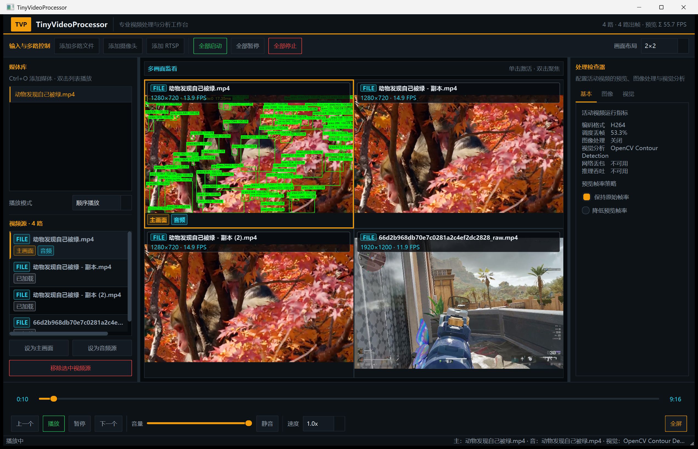

# TinyVideoProcessor UI 重构验收报告

## 1. 验收结论

- 验收日期：2026-07-17
- 开发分支：`dev_ui_refactor`
- 对比基线：`dev`
- 结论：Phase 0～Phase 7 已完成；主题、三栏工作区、多路视频源、真实运行指标、图像处理、视觉分析和关联对话框未发现阻断性 UI 回归。
- 限定结论：摄像头完成设备枚举和参数可用性检查，但未在无人值守验收中启动真实采集；RTSP 因没有可用服务端只验证输入与取消路径；跨 DPI 运行验证覆盖当前系统的 175%，未逐项覆盖 100%/125%/150%。

最终截图展示 4 路本地视频、`2×2` 布局、真实逐路 FPS、活动视频/音频标记，以及已启用的 `OpenCV Contour Detection` 视觉分析和识别叠加层：

## 2. 验收环境

| 项目 | 环境 |
| --- | --- |
| 操作系统 | Windows 桌面环境 |
| Qt | Qt 6.5.3，`msvc2019_64` Debug 套件 |
| 编译器 | Visual Studio 2022 / MSVC 19.44，x64 |
| CMake | 4.3.1 |
| 主程序构建目录 | `build/Desktop_Qt_6_5_3_MSVC2019_64bit-Debug` |
| 单元测试构建目录 | `build/unit-tests-msvc-debug` |
| 运行 DPI | 168 DPI，即 175% 缩放 |
| 截图尺寸 | 2544 × 1639 像素 |

运行前使用 Qt 6 的 `windeployqt --debug --no-translations` 部署运行依赖；构建目录和部署文件均未纳入 Git。

## 3. 静态范围与架构检查

| 检查项 | 结果 | 说明 |
| --- | --- | --- |
| 修改范围 | 通过 | `dev` 基线上的实现文件均属于已确认的 Phase 0～6 范围；Phase 7 只新增本报告与运行截图并更新指导/TODO |
| 架构边界 | 通过 | UI 继续通过 `MediaPlayController` 获取状态和发出操作，不直接访问解码器、同步器、音频输出或线程队列 |
| 指标真实性 | 通过 | FPS、分辨率、编码、调度丢帧与处理状态来自只读运行快照；网络丢包和推理吞吐保持“不可用” |
| UI 生命周期 | 通过 | 唯一 1 Hz `Qt::CoarseTimer` 在关闭和析构前停止，流移除同步清理展示与采样基线 |
| `.ui` 完整性 | 通过 | Qt 6.5.3 `uic` 成功解析；98 个 UI 对象名称唯一，45 个 `ui->` 引用均可解析 |
| 格式检查 | 通过 | `git diff --check` 无空白错误；仅存在 Git 的 LF/CRLF 工作区提示 |
| 本机配置隔离 | 通过 | Qt Creator 自动更新的 `CMakeLists.txt.user` 明确不暂存、不提交 |

`MultiViewRenderer` 只包含 Phase 4 已确认的背景、槽位和边框颜色调整；文字浮层由鼠标穿透的 `StreamViewportOverlay` 在 UI 层实现，未进入 OpenGL 帧上传、宽高比、命中或 shader 路径。

## 4. 构建与自动测试

### 4.1 主程序构建

`modernFFplay` 在 Qt 6.5.3 + MSVC Debug 环境完成重新编译和链接，结果为 `Built target modernFFplay`。Phase 6 修改的摄像头对话框、主窗口和 `.ui` 均经过真实编译。

### 4.2 单元测试

4 个测试目标均完成重新构建，并逐项运行通过：

| 测试 | 结果 |
| --- | --- |
| `test_sync_queue` | 通过 |
| `test_playlist_manager` | 通过 |
| `test_vision_config_loader` | 通过 |
| `test_vision_pipeline_manager` | 通过 |

当前 Windows/CMake 4.3.1 环境中，单次批量执行 `ctest --output-on-failure` 可稳定复现“首项通过、其余三项在 15 秒超时”的运行器异常；同一批可执行文件使用精确 `-R` 逐项运行时均在约 0.1～0.2 秒内通过，且无断言失败。该现象记录为测试调度环境限制，不能把批量命令标记为全绿；同时它不影响上述逐项测试结果。

## 5. 桌面端运行验收

| 场景 | 结果 | 运行证据 |
| --- | --- | --- |
| 启动、主题和工作区 | 通过 | 主窗口创建成功、持续响应，深色主题、三栏工作区、底部控制区和状态栏完整显示 |
| 播放与暂停 | 通过 | 状态按钮正确互斥；单路实际出帧约 23.9 FPS |
| Seek | 通过 | 进度从约 3 秒拖动到约 56 秒，时间标签同步为 `0:56` |
| 速度、音量和静音 | 通过 | 速度切换为 `1.5x`，音量设为 35，静音/取消静音文案和状态均正确 |
| 四种布局 | 通过 | 依次切换 `单画面`、`2×2`、`3×3`、`4×4`，布局值和容量入口同步更新 |
| 4 路本地文件 | 通过 | 4 路均实际出帧；启用视觉分析后的合计预览提交速率约 55.7 FPS |
| 视频浮层 | 通过 | 名称、FILE、分辨率、逐路 FPS、活动视频和活动音频标记与真实状态一致 |
| 活动视频和活动音频 | 通过 | 鼠标选择第二/第三路后分别设置，状态栏主视频和音频名称同步切换 |
| 移除流 | 通过 | 从 3 路依次移除活动流后数量降为 2、1，主视频/音频自动回退且窗口无崩溃 |
| 图像处理 | 通过 | “启用图像处理”可切换，基本信息显示“图像处理 已启用”，关闭后恢复 |
| 视觉分析 | 通过 | `OpenCV Contour Detection` 可启动和关闭；识别叠加层可启用，状态栏和基本信息同步 |
| 全局控制 | 通过 | “全部启动/全部暂停/全部停止”状态正确，停止后状态栏为“就绪 · 已停止” |
| 全屏 | 通过 | 按钮在“全屏/退出全屏”间切换，进入与退出均成功 |
| 摄像头设置 | 部分通过 | 对话框检测到 1 台摄像头且参数有效；取消路径正常，未主动启动真实采集 |
| RTSP 输入 | 部分通过 | 对话框默认值为 `rtsp://`，取消后主窗口恢复；缺少可用 RTSP 服务端，未验证真实拉流 |
| 高 DPI | 通过（当前环境） | 175% 缩放下三栏、浮层、列表、控制条和中文文本无裁切或重叠 |
| 关闭窗口 | 通过 | 多次运行均在 10 秒内干净退出，退出码为 0 |

## 6. 未覆盖项与残余风险

- 未启动实际摄像头采集，避免无人值守验收擅自拍摄用户环境；如需发布前验证，应由用户确认后执行摄像头出帧、LIVE、禁用 Seek 和关闭设备测试。
- 没有可用 RTSP 地址，因此未验证连接成功、超时、断流重连和 LIVE 状态；输入、协议前缀和取消路径已经覆盖。
- 本次只在 175% DPI 实际运行；100%/125%/150%、跨屏拖动和最小化恢复仍建议在目标发布机器复测。
- 本次压力范围为 4 路实际解码与视觉分析，未执行 16 路长时间稳定性或 GPU/CPU 性能基准。
- CTest 批量调度异常应在后续构建环境治理中单独复核；当前不建议只依据批量命令退出码判断单元测试质量。

以上项目均为环境覆盖或后续压力测试事项，未发现需要在本轮 UI 重构中修改业务代码的阻断问题。

## 7. 提交边界

本次最终提交包含 Phase 6 的关联对话框/文案收口，以及 Phase 7 的架构记录、TODO、验收报告和运行截图。`CMakeLists.txt.user`、构建目录、Qt 部署文件和其他本机生成文件全部排除。
